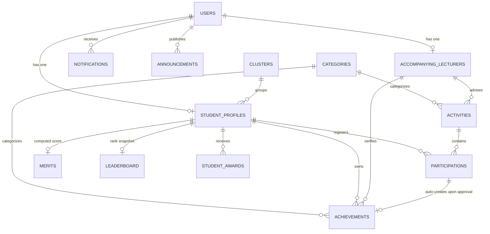

# AGENTS.md — Master Architecture & Agent Operational Guidelines

> **Project:** TalentSys (Student Talent Management System / STRMS)  
> **Faculty/Institution:** Faculty of Computer Science & Information Technology (FSKTM), Universiti Tun Hussein Onn Malaysia (UTHM)  
> **Repository:** `AzmeerHalim/jemir` (Local: `student-talent-system`)  
> **Core Stack:** Laravel 12 (PHP 8.2+), MySQL/MariaDB, Blade Templates, TailwindCSS, Alpine.js, Lucide Icons, Vite  
> **Primary Rule for AI Agents:** Read and adhere strictly to this document before and after making any modifications. Update this document whenever schema, roles, or core workflows change.

---

## 1. System Mission & Institutional Context

TalentSys is a full-lifecycle student talent and achievement tracking platform built specifically for **FSKTM, UTHM**. The platform solves the problem of scattered extracurricular and co-curricular records by providing:
1. **Verified Proof of Talent**: Two-stage verification for student activities and self-submitted achievements.
2. **Automated Merit & Real-Time Leaderboard**: Dynamically ranked student standing based on verified performance and weightings.
3. **Smart Talent-Matching**: Matching ITC activities against registered student skills and interests to auto-invite eligible candidates.
4. **Auditability & Reporting**: Executive dashboards and PDF/Excel exportable reports for faculty management and university student affairs.

---

## 2. Technology Stack & Key Dependencies

| Component | Technology / Library | Version / Details |
|---|---|---|
| **Framework** | Laravel Framework | `^12.0` (PHP `^8.2`) |
| **Authentication** | Laravel Breeze | Session-based auth with custom role-based redirects |
| **Database** | MySQL / MariaDB | Relational schema with migrations in `database/migrations` |
| **Asset Bundler** | Vite | `^7.0.7` via `laravel-vite-plugin` |
| **Frontend Styling** | TailwindCSS + `@tailwindcss/forms` | `^3.1` / Vite plugin |
| **Frontend Interactivity**| Alpine.js | Embedded for modals, sidebar toggles, and reactive tabs |
| **UI Icons** | Lucide Icons (`lucide.createIcons()`) | CDN-loaded or icon components |
| **Charts** | Chart.js | Used in dashboards and reporting views |
| **PDF Generation** | `barryvdh/laravel-dompdf` | `^3.1` |
| **Spreadsheet Exports**| `maatwebsite/excel` | `^3.1` (Export classes in `app/Exports/`) |
| **Testing** | Pest PHP + Mockery | `pestphp/pest` `^3.8` |
| **Code Style** | Laravel Pint | `^1.24` |

---

## 3. User Roles & Access Control (RBAC)

The system defines 6 core user roles mapped via the PHP backed Enum `App\Enums\UserRole`:

```php
namespace App\Enums;

enum UserRole: string
{
    case Student = 'student';
    case Coordinator = 'coordinator';
    case Lecturer = 'lecturer';
    case ItcAdmin = 'itc_admin';
    case Committee = 'committee';
    case StudentAffairs = 'student_affairs';
}
```

### Role Breakdown & Responsibilities

| Role | Enum Key | Portal Label | Route Prefix / Middleware | Primary Scope |
|---|---|---|---|---|
| **Student** | `student` | Student Portal | `/student` (`student`) | Browse activities, join & submit proof, submit achievements, view points/leaderboard/profile. |
| **Coordinator** | `coordinator` | Coordinator Portal | `/coordinator` (`coordinator`) | Final stage-2 approver, manages users, categories, awards, reports, announcements, system settings. *(Also aliased from legacy `/admin` routes)*. |
| **Lecturer** | `lecturer` | Lecturer Portal | `/lecturer` (`lecturer`) | Stage-1 verifier for assigned participations and student self-submitted achievements. |
| **ITC Admin** | `itc_admin` | ITC Admin Portal | `/itc` (`itc`) | Creates activities, configures required talents, manages talent clusters, invites matching students. |
| **Committee** | `committee` | Committee Portal | `/committee` (`management`) | Read-only talent search, student talent profiles, leaderboard inspection. |
| **Student Affairs** | `student_affairs` | Student Affairs Portal | `/affairs` (`management`) | Read-only reporting and executive analytics on achievements and student participation. |

### Middleware Registration (`bootstrap/app.php`)
```php
$middleware->alias([
    'admin' => \App\Http\Middleware\CoordinatorMiddleware::class,
    'student' => \App\Http\Middleware\StudentMiddleware::class,
    'coordinator' => \App\Http\Middleware\CoordinatorMiddleware::class,
    'lecturer' => \App\Http\Middleware\LecturerMiddleware::class,
    'itc' => \App\Http\Middleware\ItcAdminMiddleware::class,
    'management' => \App\Http\Middleware\ManagementMiddleware::class,
]);
```

---

## 4. Database Architecture & Key Entities



### Critical Entity Details & Conventions

1. **`User` (`app/Models/User.php`)**:
   - Contains core authentication credentials (`name`, `username`, `email`, `password`, `role`).
   - Links to `studentProfile()` (`hasOne(StudentProfile::class)`). Note: `student()` is deprecated in favor of `studentProfile()`.
   - Helper methods: `isStudent()`, `isCoordinator()`, `isLecturer()`, `isItcAdmin()`, `isCommittee()`, `isStudentAffairs()`, `isManagement()`.

2. **`StudentProfile` (`app/Models/StudentProfile.php`)**:
   - Stores rich student metadata: `matric_no`, `ic_number`, `phone`, `programme`, `year`, `cgpa`, `faculty`, `department`, `talent`, `skills` (JSON array), `interests` (JSON array), `cluster_id`, `student_status`.
   - Helper methods: `getTotalScore()`, `getScoreByCategory($id)`.

3. **`Activity` (`app/Models/Activity.php`)**:
   - Managed by ITC Admin.
   - Fields: `activity_name`, `activity_type`, `activity_date`, `registration_deadline`, `category_id`, `accompanying_id`, `max_participants`, `required_talents` (JSON array), `is_open`.
   - Matching logic: `matchingStudentsCount()` searches student profiles matching `required_talents` against `talent`, `skills`, and `interests`.

4. **`Participation` (`app/Models/Participation.php`)**:
   - Represents a student joining an `Activity`.
   - Verification stages: `lecturer_status` (pending/verified/rejected) → `coordinator_status` (pending/approved/rejected).
   - When coordinator approves, an `Achievement` record is automatically generated for the student.

5. **`Achievement` (`app/Models/Achievement.php`)**:
   - Two entry paths:
     1. **Self-submitted** (`participation_id === null`): Student manually enters competition/award details + evidence.
     2. **Participation-generated** (`participation_id !== null`): Created automatically upon coordinator approval of activity participation.
   - Tracked reviews: `lecturer_status` + `coordinator_status`, awarded `score`, `certificate` path, and `event_photo_path`.

6. **`Merit` & `Leaderboard`**:
   - Derived tables storing cached sums of approved achievement scores and computed global rankings.

---

## 5. Core Workflows & Business Logic

### Workflow A: Self-Submitted Achievement
```
1. Student submits achievement (Certificate, Level, Category, Event Details)
   ↳ Achievement status: pending, lecturer_status: pending, coordinator_status: pending
2. Stage 1 — Lecturer Verification:
   ↳ Lecturer reviews evidence via Lecturer Portal
   ↳ If verified: lecturer_status = 'verified'
3. Stage 2 — Coordinator Approval:
   ↳ Coordinator approves via Coordinator Portal & assigns 'score'
   ↳ coordinator_status = 'approved', status = 'approved'
4. Event Trigger (AchievementObserver):
   ↳ Fires MeritService::recomputeAll()
   ↳ Updates merits and leaderboard rankings
5. Notification:
   ↳ NotificationService dispatches notification to Student
```

### Workflow B: Activity Participation & Auto-Achievement
```
1. ITC Admin creates Activity (sets required talents & accompanying lecturer)
2. ITC Admin clicks "Invite Matched Students" (NotificationService sends invitation)
3. Student registers for Activity
4. Student attends activity and uploads proof of attendance/certificate
5. Stage 1 — Accompanying Lecturer verifies participation
6. Stage 2 — Coordinator approves participation
   ↳ Achievement record is automatically created and scored
   ↳ MeritService recomputes rankings globally
   ↳ Notification sent to Student
```

### Merit Calculation Engine (`app/Services/MeritService.php`)
- `recomputeAll()`: Loops through all `StudentProfile` models, aggregates approved achievement scores, sorts descending, and updates `merits` and `leaderboard` with `ranking` and `position`.
- **Note on scale**: Global recomputation occurs on any achievement create/update/delete via `App\Observers\AchievementObserver`. As data volume grows, this should eventually be offloaded to a queued job.

---

## 6. Directory Structure & Key Files

```
c:\Users\halim\student-talent-system/
├── app/
│   ├── Console/Commands/        # ResetDemoUsers.php (`php artisan users:reset`)
│   ├── Enums/UserRole.php       # Master role definitions
│   ├── Exports/                 # Excel exports for achievements and students
│   ├── Http/
│   │   ├── Controllers/
│   │   │   ├── Admin/           # Dashboard, settings, student management
│   │   │   ├── Auth/            # Breeze auth controllers
│   │   │   ├── Coordinator/     # Approvals, announcements, awards, users
│   │   │   ├── Itc/             # Activities, clusters, talent matching
│   │   │   ├── Lecturer/        # Verification controllers (participations & achievements)
│   │   │   ├── Management/      # Talent search & notification broadcasting
│   │   │   ├── Reports/         # PDF/Excel report exports
│   │   │   ├── Student/         # Activities, participations, announcements, notifications
│   │   │   ├── AchievementController.php
│   │   │   └── StudentController.php
│   │   └── Middleware/          # Role guards (Coordinator, Lecturer, Student, ITC, Management)
│   ├── Models/                  # 14 Eloquent Models
│   ├── Observers/               # AchievementObserver.php (triggers MeritService)
│   ├── Providers/               # AppServiceProvider.php (registers observers)
│   └── Services/                # MeritService.php, NotificationService.php
├── bootstrap/app.php            # Routing & middleware alias configuration
├── config/                      # Laravel config files
├── database/
│   ├── migrations/              # Database schema evolution
│   └── seeders/                 # DatabaseSeeder, BalancedDemoUsersSeeder, AccompanyingLecturerSeeder
├── resources/
│   ├── views/
│   │   ├── layouts/
│   │   │   ├── talentsys.blade.php  # Primary authenticated portal layout
│   │   │   └── guest.blade.php      # Auth pages layout
│   │   ├── coordinator/             # Coordinator portal views
│   │   ├── lecturer/                # Lecturer portal views
│   │   ├── itc/                     # ITC Admin portal views
│   │   ├── committee/               # Committee member views
│   │   ├── affairs/                 # Student affairs views
│   │   └── student/                 # Student portal views
├── routes/
│   ├── web.php                  # Web route definitions by role
│   ├── auth.php                 # Authentication routes
│   └── console.php              # Scheduled commands & console routes
└── tests/                       # Pest & PHPUnit tests
```

---

## 7. Developer & Agent Rules of Engagement

To keep the repository clean, reliable, and strictly aligned with UTHM FSKTM requirements, all agents MUST follow these rules:

1. **Do Not Bypass Two-Stage Approval**:
   - Self-submitted achievements and participations MUST pass through Lecturer verification before Coordinator approval unless an explicit administrative override feature is requested.
2. **Preserve UserRole Enum Integrity**:
   - Always reference `App\Enums\UserRole` cases rather than arbitrary raw strings.
   - When modifying or adding routes, check `routes/web.php` and verify the corresponding middleware alias in `bootstrap/app.php`.
3. **Maintain Observer & Service Consistency**:
   - Any programmatic update of an `Achievement` status or score must ensure `MeritService` recalculates rankings. Do not bypass `AchievementObserver` unless intentionally handling bulk recalculations manually.
4. **Preserve Documentation & Comments**:
   - Never remove existing docstrings, explanatory comments, or academic institution references (`FSKTM`, `UTHM`) when refactoring.
5. **Database & Migrations**:
   - Never alter historic migration files that have already been executed in production/testing without explicit instruction. Always generate new incremental migrations.
   - Use `StudentProfile` for student attributes rather than the deprecated `Student` model where possible.
6. **Agent Drift Prevention**:
   - Whenever you create or modify an architectural pattern, new model, role, service, or major route group, **update this `AGENTS.md` file immediately** so that future conversations remain synchronized with reality.

---

## 8. Operational Commands Reference

```bash
# Start development servers
php artisan serve
npm run dev

# Reset and seed demo accounts with balanced roles
php artisan users:reset --force

# Run database migrations
php artisan migrate

# Clear application caches
php artisan optimize:clear

# Run code style formatting
./vendor/bin/pint

# Run test suite
php artisan test
```
